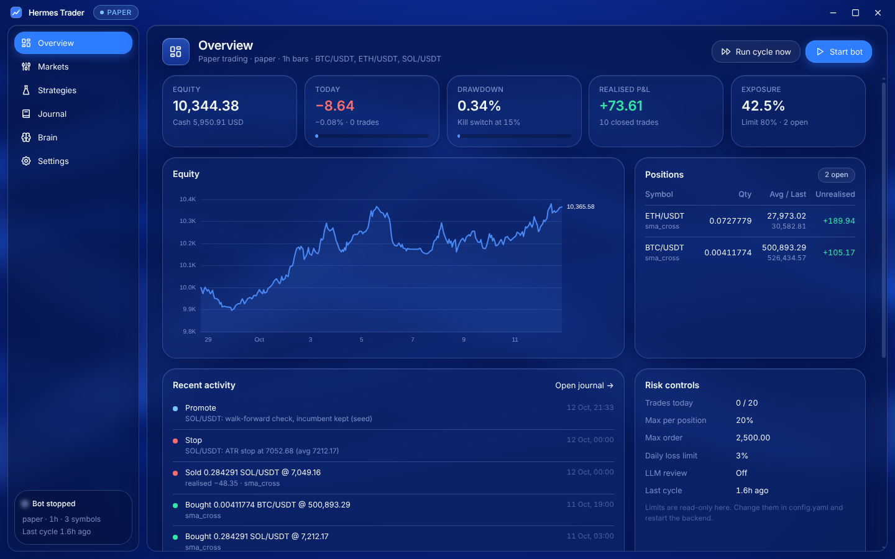

# Hermes Trader ☤📈

A lean, self-improving trading agent distilled from [Nous Research's Hermes Agent](https://github.com/NousResearch/hermes-agent).

The original Hermes is a general-purpose assistant: about 18,000 files and 247 MB, with chat gateways, desktop apps, browser automation, TTS, a website and 35 locales. This branch keeps only the ideas that matter for trading and rebuilds them as **~3,500 lines of Python with 4 core dependencies**:

| Kept from Hermes | Became |
|---|---|
| Model-agnostic LLM loop with tool calling | `agent/llm.py`, `agent/loop.py` (any OpenAI-compatible endpoint: OpenRouter, Nous Portal, OpenAI, Ollama, vLLM… plus native Anthropic Claude API) |
| `MEMORY.md` curated memory | `LESSONS.md`: short, falsifiable trading lessons with a character budget |
| Skills (procedural memory, agentskills.io format) | `hermes_trader/playbooks/*/SKILL.md`: regime checks, drawdown response, onboarding. The agent can write its own. |
| Background self-review after work | `reflect`: reviews the trade journal, records lessons, re-optimises underperformers |
| Cron scheduler | Bar-close scheduler (`run`) plus daily walk-forward re-optimisation |
| `SOUL.md` persona | Trading persona: sceptical, capital-preservation first |
| Telegram gateway | One function: Telegram trade and alert notifications |

## Architecture

```
            ┌──────────── every bar close ─────────────┐
 broker ──► data ──► strategy ──► ATR stop ──► RISK ──► (LLM review: shrink/veto only) ──► execute ──► journal
 (paper │ ccxt │ alpaca)     ▲                  hard limits                                         │
                             │                                                                     ▼
                     strategy_book.yaml ◄── walk-forward optimizer (daily) ◄── reflection (every N trades)
                     (versioned, rollback)         gates: OOS score, trades, DD       writes LESSONS.md + playbooks
```

**Safety design**
- The bot trades **without** an LLM. The LLM is an optional overlay that can only *shrink or veto* new risk. It can never enlarge an order or block an exit. If the LLM is down, the bot proceeds on strategy + risk alone and logs it.
- Risk limits live only in `config.yaml`. The agent has no tool to change them.
- Strategy changes go through a **walk-forward gate**. The optimiser ranks candidates on the first 70% of history only and picks one challenger. It tests that challenger once on the unseen last 30%, and promotes it only if it beats the incumbent's holdout score by a margin, with enough trades and acceptable drawdown. LLM-requested promotions go through the same gate and are limited to one attempt per symbol per day. On 20 pure random walks, 1 in 20 got promoted.
- If the LLM is down or replies with something unreadable, new trades go ahead at half size (`on_review_error: reduce`). You can change this to `veto` or `proceed`.
- Circuit breakers: a daily loss limit switches to reduce-only, and a max-drawdown **kill switch** flattens everything and halts until you run `resume`.
- Paper mode is the default. A paper config pointed at a real exchange is refused. `mode: live` also needs the env latch `HERMES_TRADER_LIVE=I_UNDERSTAND_REAL_MONEY`.

## Quick start

```bash
pip install -e ".[crypto]"         # ccxt for crypto exchanges; Alpaca needs nothing extra
hermes-trader init                  # creates config.yaml + .env
hermes-trader backtest BTC/USDT     # offline synthetic data by default
hermes-trader optimize --promote    # walk-forward search across all strategies
hermes-trader run --once            # one trading cycle (cron-friendly)
hermes-trader run                   # loop on every bar close
hermes-trader status                # equity, positions, risk state
```

### Pick a market (edit `config.yaml`)

**Crypto paper trading on real prices (no keys needed):**
```yaml
broker: {name: paper, data_source: ccxt, exchange: binance}
symbols: [BTC/USDT, ETH/USDT, SOL/USDT]
```

**Crypto on an exchange testnet** (put `BINANCE_API_KEY`/`BINANCE_SECRET` testnet keys in `.env`):
```yaml
broker: {name: ccxt, exchange: binance, sandbox: true}
```

**US stocks and ETFs with Alpaca's free paper account** (put `ALPACA_API_KEY_ID`/`ALPACA_API_SECRET_KEY` in `.env`):
```yaml
broker: {name: alpaca}
symbols: [SPY, QQQ, AAPL]          # crypto on Alpaca: BTC/USD
timeframe: 1h
```
Equity symbols are skipped automatically while the market is closed.

### Turn on the LLM brain (optional)
```yaml
llm:
  enabled: true
  base_url: https://openrouter.ai/api/v1      # or http://localhost:11434/v1 (Ollama, free, local)
  model: nousresearch/hermes-4-70b
```
Set `LLM_API_KEY` in `.env`.

To use Claude directly with an Anthropic API key, use these settings:
```yaml
llm:
  enabled: true
  provider: anthropic
  base_url: https://api.anthropic.com
  model: claude-haiku-5-5        # or claude-sonnet-5-5 / claude-opus-5-5
```
The key is a Claude Console API key (`sk-ant-api…`, from platform.claude.com → API keys) and goes in `LLM_API_KEY` or `ANTHROPIC_API_KEY`. A Claude.ai Pro/Max login can't be used: Anthropic's terms keep subscription logins inside its own apps.

Check the setup with one live call, then use it:
```bash
hermes-trader llm                   # checks key, URL, model id and tool calling
hermes-trader chat "how is ETH doing and is the current strategy still right for it?"
hermes-trader reflect               # force a self-review now
hermes-trader lessons               # what it has learned
```
In `chat`, the agent can also place manual orders. Every one needs you to type `yes`, and the risk caps still apply.

## JEV decision model (optional)

[TypeSafe's Jev](https://openrouter.ai/docs/guides/community/jev) is a non-generative decision model that returns calibrated probabilities. Here it scores every new entry: *is this entry worth taking?* It also labels the market regime. The bot computes all the numbers itself and sends Jev the facts.

1. Put `TYPESAFE_API_KEY=...` in `.env`. In `config.yaml`, set `jev: {enabled: true, mode: shadow}`.
2. Run `hermes-trader jev --test` to make one live call and confirm the key and endpoint work.
3. Let it run in **shadow** mode, which scores entries but changes nothing. Each scored entry's outcome is recorded when the position closes.
4. Check `hermes-trader jev` or the app's **Brain → JEV** tab. They show calibration by probability band, the Brier score against the base rate, P&L by regime, and what gating would have changed. They won't suggest gating until `min_shadow_trades` scored trades have closed and Jev has shown an edge.
5. Only then set `mode: gate`. Below `veto_below` the entry is skipped, and below `reduce_below` it's halved. Jev never enlarges an order and never sees exits. If Jev is unreachable, `on_error` (default `proceed`) decides what happens.

**Every-bar checks (`jev.checks`, on whenever JEV is on).** Once per bar, for every symbol, a single JEV request also asks:
- **regime:** trending up, trending down, ranging or volatile.
- **strategy_fits:** does this strategy's style suit the market right now?
- **exit_now** (only when holding a position): has the reason to hold gone away?

About 72 calls a day for 3 symbols on 1h bars costs roughly $0.002. Each answer is scored against what price actually did `horizon_bars` later. Price moves whether or not the bot acted, so this scoring keeps working in act mode too. In `mode: act` the checks can only reduce risk:
- A low fit makes the strategy **stand aside**, meaning no new entries. Existing positions, stops and exits still work.
- A high exit probability **closes the position**, with no re-entry until the strategy's own signal resets.

The Brain → JEV tab shows the evidence for each check, so you can promote them independently of the entry gate.

OpenRouter works too: set `url: https://openrouter.ai/api/alpha/decisions`, `model: ~typesafe/jev-latest`, `api_key_env: OPENROUTER_API_KEY`.

## Entry filters (price action, volatility maths, order flow)

Five rule-based checks run on every **new entry**. They never touch exits. Like JEV, they start in **shadow** mode, which records what each filter would have done and changes nothing.

| Filter | Idea | Fails when |
|---|---|---|
| `levels` | Price action: don't buy into resistance | The distance to the next key level is less than `min_rr` × the ATR stop. Key levels are daily/weekly swing highs and lows, the previous day/week high and low, and round numbers |
| `stretch` | Black-Scholes-Merton volatility maths: don't chase | The last 24 bars moved more than ±2σ in the trade's direction |
| `flow` | Order flow | A CVD divergence points against the trade. Needs taker volume (Binance); otherwise it passes |
| `vol` | Volatility regime | Realised vol is more than 2× its normal level, or implied vol is more than 1.3× its own 30-day median. Implied vol comes from Deribit DVOL for BTC/ETH and CBOE VIX for stocks. In act mode it halves the size instead of skipping |
| `events` | Macro calendar | The entry falls within ±60 min of a listed FOMC or CPI release. The built-in list runs to 2027; keep it updated |

```bash
hermes-trader filters                                         # live shadow stats per filter
hermes-trader filters --backtest BTC/USDT --strategy rsi_reversion   # replay history now
```

The replay runs a strategy's past entries through the filters, with no look-ahead. It shows whether the trades a filter would block did worse than the ones it keeps. When one clearly helps a strategy, set that filter's `mode: act` in `config.yaml`. The app's **Brain → Filters** tab shows the same evidence and has a Replay button. The **Markets** chart shows the nearest key levels, a ±1σ/±2σ expected-move cone for the next 24 bars, and a CVD panel when the venue has order-flow data. The LLM and JEV also receive these facts.

## Desktop app

<p align="center"></p>

A Linux desktop app in the Herald OS "deep-blue glass" style. It covers the overview, candles with the bot's fills, the strategy book (with walk-forward search and roll-back), a backtest lab, the journal, lessons and playbooks, and chat. It talks to the bot through a local, token-protected API (`hermes-trader serve`).

```bash
cd desktop && npm install && npm start
```

See [desktop/README.md](desktop/README.md) for connection modes (the app starts the bot, or attaches to one you run 24/7) and the safety model.

## Commands

| Command | What it does |
|---|---|
| `init` | Create `config.yaml` and `.env` from the examples |
| `backtest SYMBOL [--strategy S --params JSON --bars N]` | Backtest with fees and slippage, compared with buy-and-hold |
| `optimize [SYMBOL] [--promote]` | Walk-forward search; promotes only gate-passing winners |
| `run [--once]` | Trade on bar close; re-optimises daily, reflects every N closed trades |
| `status` / `journal` / `book` / `lessons` | Inspect state, live P&L, active strategies, memory |
| `flatten` / `halt` / `resume` | Emergency controls |
| `rollback SYMBOL` | Revert to the previous strategy version |
| `chat` / `reflect` | Talk to the agent / run a self-review |
| `jev [--test]` | JEV calibration report / one live test call |
| `filters [--backtest SYM --strategy S]` | Entry-filter shadow stats / replay a strategy's history through the filters |
| `llm` | One live LLM call to check the key, URL, model and tool calling |
| `serve [--port N] [--run]` | Local API for the desktop app (127.0.0.1 only, token auth); `--run` starts trading immediately |
| `download SYMBOL --bars N` | Save history to CSV (`data_source: csv`) |

## Strategies

`sma_cross`, `ema_cross`, `donchian_breakout` (trend); `rsi_reversion`, `bollinger_reversion`, `trend_rsi` (mean reversion); `fib_retracement` (pullback); `market_structure` (price action: buy the retest after a break of structure, exit when structure breaks). `flow_reversal` (order flow: absorption at a range extreme, then initiation; needs taker volume, which Binance provides). `fib_retracement` buys a dip to a Fibonacci retracement (38.2%, 50% or 61.8%) of the last swing and exits if price breaks 78.6% or 100%, or reaches the swing high or the 127.2% extension. Shorts mirror this. To add your own, subclass `Strategy`, implement `targets(df)` returning exposure in [-1, 1], and `register()` it. The no-look-ahead test runs automatically over every registered strategy.

## Layout

```
hermes_trader/
  config.py  models.py  indicators.py  backtest.py  data.py
  risk.py  engine.py  journal.py  book.py  improve.py  runtime.py  cli.py
  brokers/   base.py  paper.py  ccxt_broker.py  alpaca_broker.py
  strategies/ base.py  builtin.py
  agent/     llm.py  loop.py  tools.py  memory.py  prompts.py
  playbooks/ bundled procedural playbooks (SKILL.md)
  templates/ config.example.yaml, env.example (copied by `init`)
  server.py  local API for the desktop app
desktop/     Electron app (Herald OS stack and design)
tests/       75 tests: no-look-ahead, holdout isolation, risk limits, kill switch, stop cooldown, broker adapters, LLM veto/clamp, gated promotion, API auth/locking/shutdown
```

Runtime state lives in `data/` (`journal.sqlite`, `strategy_book.yaml`, `LESSONS.md`, `playbooks/`, broker state). Back it up, because this is what the bot has learned.

## Docker
```bash
docker build -t hermes-trader .
docker run -d --name trader --env-file .env -v $PWD/config.yaml:/app/config.yaml -v $PWD/data:/app/data hermes-trader
```

## Honest caveats
- Backtests on synthetic data only prove that the plumbing works. Use real history (`data_source: ccxt` or `alpaca`, or CSV) before trusting any strategy.
- Walk-forward gating reduces overfitting; it does not eliminate it. Paper trade for weeks before considering `mode: live`.
- Spot or cash only. There is no leverage, margin or derivatives support, by design.
- ccxt: use one quote currency for all symbols (for example all `/USDT`). The bot only tracks and trades coins it bought itself, so anything you already held is never sold.
- The agent's `run_backtest` tool can still look at the whole history. The promotion gate and rate limit stop it from acting on what it sees there, but a human can always over-fit by hand.
- This is not financial advice. You are responsible for any orders it places.

## License
MIT. Derived from Hermes Agent © Nous Research (see `LICENSE` and `NOTICE`).
